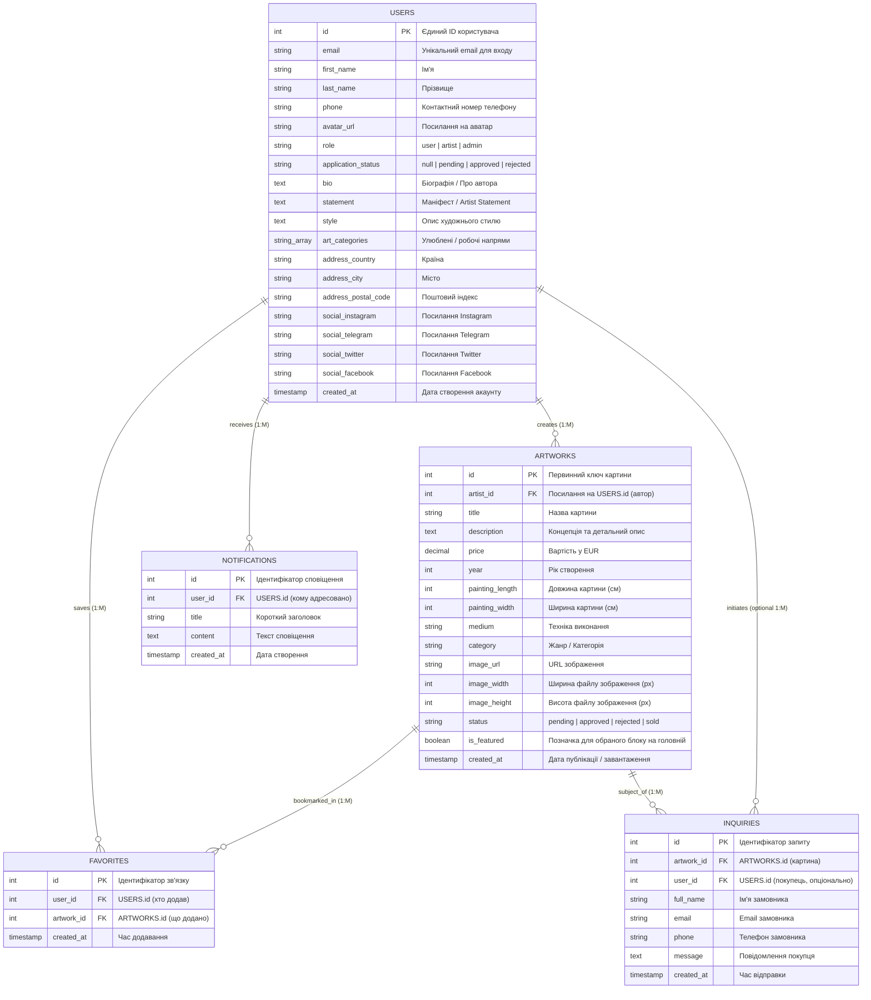
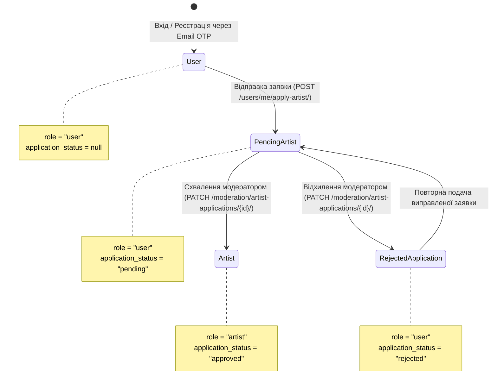
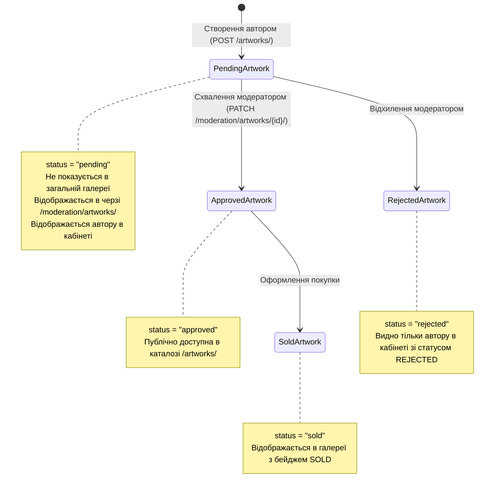

# 📜 Архітектурна специфікація та REST API Контракт: Онлайн-Галерея

> **Версія специфікації:** 2.0.0  
> **Формат:** RESTful API / JSON / Multipart FormData  
> **Аутентифікація:** Bearer JWT (`Authorization: Bearer <access_token>`)  
> **Базовий префікс:** Відсутній (ендпоінти монтуються в кореневому домені `/`)  

---

## 📌 Зміст
1. [Головні архітектурні принципи та виправлення](#1-головні-архітектурні-принципи-та-виправлення)
2. [Структура бази даних та зв'язки між сутностями (ER-діаграма)](#2-структура-бази-даних-та-звязки-між-сутностями-er-діаграма)
3. [Життєвий цикл сутностей та логіка статусів](#3-життєвий-цикл-сутностей-та-логіка-статусів)
4. [Уніфікований формат відповідей та пагінація](#4-уніфікований-формат-відповідей-та-пагінація)
5. [Базові типи даних та Enums](#5-базові-типи-даних-та-enums)
6. [Специфікація ендпоінтів](#6-специфікація-ендпоінтів)
   - [6.1. Автентифікація (Auth & JWT)](#61-автентифікація-auth--jwt)
   - [6.2. Поточний користувач (`/users/me/`)](#62-поточний-користувач-usersme)
   - [6.3. Публічні художники (`/artists/`)](#63-публічні-художники-artists)
   - [6.4. Картини та каталог (`/artworks/`)](#64-картини-та-каталог-artworks)
   - [6.5. Замовлення та запити (`Inquiries`)](#65-замовлення-та-запити-inquiries)
   - [6.6. Модерація та панель адміністратора (`/moderation/`)](#66-модерація-та-панель-адміністратора-moderation)
   - [6.7. Сервісні форми (Contact & Newsletter)](#67-сервісні-форми-contact--newsletter)

---

## 1. Головні архітектурні принципи та виправлення

Ця специфікація є єдиним джерелом правди (Single Source of Truth) для клієнтської та серверної частин. Усі попередні конфлікти моделей вирішено відповідно до таких вимог:

1. **Єдина сутність Користувача (`Users`):**
   - У системі є лише **одна таблиця користувачів** для всіх ролей (`user`, `artist`, `admin`).
   - У користувача існує **один-єдиний первинний ключ `id` на верхньому рівні**.
   - **Категорична заборона:** Не створювати вкладених об'єктів `artist: { id: ... }` всередині профілю. Будь-які додаткові дані автора належать тій самій сутності користувача.
2. **Єдиний кабінет поточного користувача — `/users/me/`:**
   - Після валідації JWT-токена будь-який користувач (покупець, автор чи модератор) отримує свої актуальні дані через `GET /users/me/`.
   - Заборонено розділяти ендпоінти входу на `/users/`, `/artists/`, `/admins/`, оскільки до моменту запиту клієнт не знає ролі користувача.
   - Під час OTP-автентифікації (`POST /users/authenticate/`) сервер зобов'язаний повернути **одразу токени та повний об'єкт `user`**.
3. **Публічний каталог художників (`/artists/`):**
   - Ендпоінти `GET /artists/` та `GET /artists/{id}/` повертають дані **виключно тих користувачів, у яких `role === 'artist'`**. Звичайні покупці без статусу автора туди не потрапляють.
   - Ідентифікатор `{id}` у маршруті `/artists/{id}/` — це той самий `Users.id`.
4. **Усунення колізії маршрутів (Префікс `/moderation/`):**
   - Оскільки службовий шлях `/admin/` зарезервовано системною панеллю керування бекенду, усі API-ендпоінти модерації винесено в простір імен **`/moderation/...`**.
5. **Чистий REST для оновлення профілю та аватара:**
   - Оновлення текстових даних, адрес та соцмереж здійснюється суворо через `PATCH /users/me/` у форматі `application/json`.
   - Завантаження бінарного файлу аватара винесено в окремий ендпоінт `POST /users/me/avatar/` (`multipart/form-data`). Це усуває конфлікти парсингу вкладених JSON-структур у Form-Data.
6. **Очищення від внутрішніх полів фреймворку:**
   - Поля `is_superuser`, `is_staff`, `groups`, `user_permissions`, `number_of_paid_cell` **не повинні бути присутніми у вихідних REST-відповідях**.

---

## 2. Структура бази даних та зв'язки між сутностями (ER-діаграма)

### 2.1. Концептуальна ER-діаграма


### 2.2. Принципи реалізації зв'язків:
1. **Збереження даних автора без дублювання ID:**
   Усі авторські поля (`bio`, `statement`, `style`, `art_categories`, `application_status`) перебувають у контексті таблиці `USERS`. Навіть якщо на рівні реляційної моделі авторські дані виносяться в дочірню таблицю (One-to-One), її первинним ключем зобов'язаний бути `user_id`. Клієнтська сторона бачить ці дані як єдину пласку сутність або вкладений блок без окремого другого ID.
2. **Зв'язок Автор ➔ Картини (One-to-Many):**
   Поле `artist_id` у таблиці `ARTWORKS` посилається безпосередньо на `USERS.id`.
3. **Обране (Many-to-Many):**
   Зв'язок реалізується через таблицю `FAVORITES` з унікальним композитним обмеженням `UNIQUE(user_id, artwork_id)`.
4. **Сповіщення (One-to-Many):**
   Таблиця `NOTIFICATIONS` зберігає повідомлення для користувачів. Нові записи створюються автоматично на стороні сервера під час зміни статусу модерації або надходження замовлення на картину.

---

## 3. Життєвий цикл сутностей та логіка статусів

### 3.1. Ролі користувача та заявка на художника


* **Автоматична зміна ролі:** Коли модератор передає статус `"approved"`, сервер **автоматично** змінює поле `role` користувача з `"user"` на `"artist"`.
* Якщо статус `"rejected"`, поле `role` залишається `"user"`.

---

### 3.2. Життєвий цикл картини (Artwork Lifecycle)


---

## 4. Уніфікований формат відповідей та пагінація

Усі спискові відповіді API, що підтримують пагінацію, повертають стандартизовану структуру з полями `data` та `meta`:

```json
{
  "data": [ /* масив об'єктів */ ],
  "meta": {
    "total": 48,
    "page": 1,
    "limit": 12,
    "totalPages": 4
  }
}
```

* `meta.total` — загальна кількість знайдених записів;
* `meta.page` — поточний номер сторінки (нумерація з 1);
* `meta.limit` — ліміт кількості елементів на сторінку;
* `meta.totalPages` — загальна кількість сторінок (`ceil(total / limit)`).

---

## 5. Базові типи даних та Enums

Усі значення рядкових переліків узгоджено з клієнтським кодом TypeScript:

### 5.1. Enums
* **`RoleEnum`**: `"user"` | `"artist"` | `"admin"`
* **`ApplicationStatusEnum`**: `"pending"` | `"approved"` | `"rejected"`
* **`ArtworkStatusEnum`**: `"pending"` | `"approved"` | `"rejected"` | `"sold"`
* **`ArtworkCategoryEnum`** *(зверніть увагу: `pop_art` строго через підкреслення, без пробілу)*:
  * `"modern"`
  * `"portrait"`
  * `"abstractionism"`
  * `"cubism"`
  * `"surrealism"`
  * `"pop_art"`
  * `"impressionism"`
  * `"landscape"`
  * `"still_life"`
  * `"romanticism"`
* **`ArtworkMediumEnum`**:
  * `"oil"` (Олія)
  * `"acrylic"` (Акрил)
  * `"watercolor"` (Акварель)
  * `"graphics"` (Графіка)
  * `"mixed_media"` (Змішана техніка)
  * `"lithography"` (Літографія)
* **`ArtworkSortEnum`**:
  * `"price_asc"` | `"price_desc"`
  * `"date_asc"` | `"date_desc"`
  * `"year_asc"` | `"year_desc"`
  * `"size_asc"` | `"size_desc"`

---

### 5.2. Модель повного профілю користувача (`UserDetail`)
*Поле контактного телефону стандартизовано як **`phone`**.*

```json
{
  "id": 10,
  "email": "alex.artist@example.com",
  "first_name": "Alex",
  "last_name": "Shevchenko",
  "phone": "+380501234567",
  "avatar_url": "https://res.cloudinary.com/.../avatar.jpg",
  "role": "artist",
  "application_status": "approved",
  "bio": "Contemporary Ukrainian artist focused on neo-expressionism and minimalism.",
  "statement": "Art is the only truth that cannot be silenced.",
  "style": "Expressionism, abstract compositions, layered oil techniques.",
  "art_categories": ["abstractionism", "modern"],
  "address": {
    "country": "Ukraine",
    "city": "Kyiv",
    "postal_code": "01001"
  },
  "social_media": {
    "instagram": "https://instagram.com/alex_art",
    "telegram": "https://t.me/alex_art",
    "twitter": "",
    "facebook": ""
  },
  "favorite_artworks": [1, 5, 14],
  "date_joined": "2026-02-15T10:30:00Z"
}
```

---

### 5.3. Модель картини (`Artwork`)
```json
{
  "id": 1,
  "title": "Whispers of the Horizon",
  "image_url": "https://res.cloudinary.com/.../artwork_1.webp",
  "image_width": 800,
  "image_height": 1000,
  "painting_length": 100,
  "painting_width": 80,
  "price": "3500.00",
  "year": 2024,
  "medium": "oil",
  "category": "landscape",
  "description": "Oil on canvas, deep texture representing morning mist over Dnieper river.",
  "status": "approved",
  "is_featured": true,
  "created_at": "2026-03-01T14:20:00Z",
  "artist": {
    "id": 10,
    "first_name": "Alex",
    "last_name": "Shevchenko",
    "avatar_url": "https://res.cloudinary.com/.../avatar.jpg"
  }
}
```

---

## 6. Специфікація ендпоінтів

### 6.1. Автентифікація (Auth & JWT)

#### `POST /users/code/`
Генерація та відправка 6-значного OTP-коду на вказаний email. Якщо користувача з такою поштою немає, він автоматично створюється з роллю `user`.
* **Доступ:** Публічний
* **Content-Type:** `application/json`
* **Request Body:**
  ```json
  {
    "email": "user@example.com"
  }
  ```
* **Response 200 OK:**
  ```json
  {
    "message": "Verification code sent to your email"
  }
  ```
* **Response 400 Bad Request:**
  ```json
  {
    "detail": "Invalid email address format"
  }
  ```

---

#### `POST /users/authenticate/`
Перевірка OTP-коду. Повертає пару JWT-токенів **ТА повний об'єкт користувача**.
* **Доступ:** Публічний
* **Content-Type:** `application/json`
* **Request Body:**
  ```json
  {
    "email": "user@example.com",
    "code": "123456"
  }
  ```
* **Response 200 OK:**
  ```json
  {
    "access": "eyJhbGciOiJIUzI1NiIsIn...",
    "refresh": "eyJhbGciOiJIUzI1NiIsIn...",
    "user": {
      "id": 10,
      "email": "user@example.com",
      "first_name": "Alex",
      "last_name": "Shevchenko",
      "phone": "+380501234567",
      "avatar_url": "https://res.cloudinary.com/.../avatar.jpg",
      "role": "user",
      "application_status": null,
      "bio": "",
      "statement": "",
      "style": "",
      "art_categories": [],
      "address": {
        "country": "Ukraine",
        "city": "Kyiv",
        "postal_code": "01001"
      },
      "social_media": {
        "instagram": "",
        "telegram": "",
        "twitter": "",
        "facebook": ""
      },
      "favorite_artworks": [],
      "date_joined": "2026-10-12T09:00:00Z"
    }
  }
  ```
* **Response 400 Bad Request / 401 Unauthorized:**
  ```json
  {
    "detail": "Invalid or expired verification code"
  }
  ```

---

#### `POST /users/token/refresh/`
Отримання свіжого `access`-токена за дійсним `refresh`-токеном.
* **Доступ:** Публічний
* **Content-Type:** `application/json`
* **Request Body:**
  ```json
  {
    "refresh": "eyJhbGciOiJIUzI1NiIsIn..."
  }
  ```
* **Response 200 OK:**
  ```json
  {
    "access": "eyJhbGciOiJIUzI1NiIsIn..."
  }
  ```

---

### 6.2. Поточний користувач (`/users/me/`)

#### `GET /users/me/`
Отримання даних поточного авторизованого користувача на основі JWT токена (`Authorization: Bearer <access_token>`).
* **Доступ:** Будь-який авторизований користувач
* **Response 200 OK:** Повертає об'єкт `UserDetail` (див. п. 5.2).

---

#### `PATCH /users/me/`
Часткове оновлення текстових даних профілю, контактів, адреси та соцмереж.
* **Доступ:** Авторизований користувач
* **Content-Type:** Суворо `application/json`
* **Request Body (JSON):** *(усі поля опціональні)*
  ```json
  {
    "first_name": "Alexander",
    "last_name": "Shevchenko",
    "phone": "+380509999999",
    "bio": "Updated bio text...",
    "address": {
      "country": "Ukraine",
      "city": "Lviv",
      "postal_code": "79000"
    },
    "social_media": {
      "instagram": "https://instagram.com/alex_art_new",
      "telegram": "https://t.me/alex_art"
    }
  }
  ```
* **Response 200 OK:** Повертає оновлений об'єкт `UserDetail`.

---

#### `POST /users/me/avatar/`
Завантаження або заміна аватара поточного користувача.
* **Доступ:** Авторизований користувач
* **Content-Type:** `multipart/form-data`
* **Request Form-Data:**
  * `avatar` (binary file, обов'язкове, формати `.jpg`, `.png`, `.webp`)
* **Response 200 OK:**
  ```json
  {
    "avatar_url": "https://res.cloudinary.com/.../new_avatar.webp"
  }
  ```

---

#### `POST /users/me/apply-artist/`
Подання анкети звичайного користувача (`role: "user"`) для переходу в статус автора.
* **Доступ:** Авторизовані користувачі з `role: "user"`
* **Content-Type:** `application/json`
* **Бізнес-правило:** Змінює поле `application_status` користувача на `"pending"`.
* **Request Body:**
  ```json
  {
    "bio": "I have been painting for 10 years, graduating from the National Academy of Arts.",
    "statement": "My work reflects urban loneliness and harmony with nature.",
    "style": "Contemporary Abstract Expressionism",
    "art_categories": ["abstractionism", "modern"]
  }
  ```
* **Response 200 OK:**
  ```json
  {
    "message": "Artist application submitted successfully and is pending review",
    "application_status": "pending"
  }
  ```

---

#### `GET /users/me/favorites/`
Отримання списку картин, доданих користувачем у вибране (для сторінки `/profile/favorites`).
* **Доступ:** Авторизований користувач
* **Query Parameters:** `page` (int), `limit` (int)
* **Response 200 OK:** Пагінована відповідь `{ data: Artwork[], meta: PaginationMeta }`.

---

#### `GET /users/me/notifications/`
Отримання списку сповіщень користувача (для сторінки `/profile/notifications`).
* **Доступ:** Авторизований користувач
* **Response 200 OK:**
  ```json
  [
    {
      "id": 1,
      "date": "12/10",
      "title": "YOUR ARTIST APPLICATION HAS BEEN APPROVED!",
      "content": "Congratulations! Your profile has been upgraded to Artist. You can now upload artworks for sale in the gallery.",
      "created_at": "2026-10-12T10:00:00Z"
    },
    {
      "id": 2,
      "date": "08/10",
      "title": "NEW INQUIRY FOR YOUR ARTWORK \"WHISPERS OF THE HORIZON\"",
      "content": "Buyer John Doe (+380501112233, john@example.com) is interested in purchasing your artwork.",
      "created_at": "2026-10-08T15:30:00Z"
    }
  ]
  ```

---

### 6.3. Публічні художники (`/artists/`)

#### `GET /artists/`
Отримання списку верифікованих авторів платформи.
* **Доступ:** Публічний
* **Фільтрація:** Сервер повертає тільки тих, у кого `role = "artist"` та `application_status = "approved"`.
* **Query Parameters:** `page`, `limit`, `search` (опціонально).
* **Response 200 OK:**
  ```json
  {
    "data": [
      {
        "id": 10,
        "first_name": "Alex",
        "last_name": "Shevchenko",
        "avatar_url": "https://res.cloudinary.com/.../avatar.jpg",
        "role": "artist",
        "art_categories": ["abstractionism", "modern"],
        "artworks": [1, 4, 12]
      }
    ],
    "meta": {
      "total": 15,
      "page": 1,
      "limit": 12,
      "totalPages": 2
    }
  }
  ```

---

#### `GET /artists/{id}/`
Публічний профіль автора (де `{id}` — це `Users.id`).
* **Доступ:** Публічний
* **Бізнес-правило:** Якщо користувач не має ролі `'artist'`, повертається `404 Not Found`.
* **Response 200 OK:**
  ```json
  {
    "id": 10,
    "first_name": "Alex",
    "last_name": "Shevchenko",
    "avatar_url": "https://res.cloudinary.com/.../avatar.jpg",
    "role": "artist",
    "bio": "Contemporary Ukrainian artist focused on neo-expressionism and minimalism.",
    "statement": "Art is the only truth that cannot be silenced.",
    "style": "Expressionism, abstract compositions, layered oil techniques.",
    "art_categories": ["abstractionism", "modern"],
    "artworks": [1, 4, 12],
    "social_media": {
      "instagram": "https://instagram.com/alex_art",
      "telegram": "https://t.me/alex_art",
      "twitter": "",
      "facebook": ""
    }
  }
  ```

---

### 6.4. Картини та каталог (`/artworks/`)

#### `GET /artworks/`
Каталог картин галереї з фільтрацією, сортуванням та пагінацією.
* **Доступ:** Публічний
* **Дефолтна фільтрація статусів:** Якщо параметр `status` не передано, сервер повертає лише картини зі статусом `approved` та `sold`.
* **Підтримувані Query-параметри:**
  * `page` (int, default: `1`)
  * `limit` (int, default: `12`)
  * `sort` (`price_asc`, `price_desc`, `date_asc`, `date_desc`, `year_asc`, `year_desc`, `size_asc`, `size_desc`)
  * `category` (рядок через кому: наприклад, `modern,landscape,pop_art`)
  * `medium` (рядок через кому: наприклад, `oil,acrylic`)
  * `size` (рядок через кому: наприклад, `20x25,30x40`)
  * `status` (рядок через кому: наприклад, `approved,sold` або для автора в кабінеті `pending,approved,sold,rejected`)
  * `price_lte` (number: максимальна ціна)
  * `year_lte` (number: максимальний рік створення)
  * `is_featured` (boolean: фільтр промо-картин для головної)
  * `artist` (int: `Users.id` для отримання робіт конкретного автора)
* **Response 200 OK:** Пагінована відповідь `{ data: Artwork[], meta: PaginationMeta }` (див. п. 4 та п. 5.3).

---

#### `POST /artworks/`
Створення картини автором (з форми `ProfileNewArt.tsx`).
* **Доступ:** Тільки авторизовані користувачі з `role: "artist"` (або `"admin"`).
* **Content-Type:** `multipart/form-data`
* **Бізнес-правила:**
  1. Автор (`artist_id`) визначається автоматично з валідного JWT токена.
  2. Картина створюється зі статусом `status: "pending"`.
  3. Розміри файлу (`image_width`, `image_height`) розраховуються на сервері під час завантаження.
* **Form-Data Fields:**
  * `title` (string, обов'язкове)
  * `painting_width` (integer, обов'язкове, в см)
  * `painting_length` (integer, обов'язкове, в см)
  * `year` (integer, обов'язкове)
  * `medium` (string: `oil`, `acrylic` тощо, обов'язкове)
  * `category` (string: `modern`, `pop_art` тощо, обов'язкове)
  * `description` (string, обов'язкове)
  * `price` (decimal/number, обов'язкове)
  * `image` (binary file, обов'язкове)
* **Response 201 Created:** Повертає створений об'єкт `Artwork` зі статусом `pending`.

---

#### `GET /artworks/{id}/`
Детальна інформація про картину (для сторінки `/gallery/:id`).
* **Доступ:** Публічний
* **Response 200 OK:** Повертає об'єкт `Artwork`.
* **Response 404 Not Found:** Якщо картину не знайдено або вона має статус `pending`/`rejected` (доступні лише автору та модератору).

---

#### `PUT/PATCH /artworks/{id}/`
Редагування картини.
* **Доступ:** Автор картини (`artist.id === auth_user.id`) або адміністратор.
* **Response 200 OK:** Повертає оновлений об'єкт `Artwork`.

---

#### `DELETE /artworks/{id}/`
Видалення картини.
* **Доступ:** Автор картини або адміністратор.
* **Response 204 No Content.**

---

#### `POST /artworks/{id}/favorite/`
Toggle-перемикач для сердечка (`ArtworkCard`): додає картину у вибране, якщо її там немає, або видаляє, якщо вона вже збережена.
* **Доступ:** Авторизований користувач
* **Response 200 OK:**
  ```json
  {
    "is_favorite": true,
    "favorite_artworks": [1, 5, 14, 15]
  }
  ```

---

### 6.5. Замовлення та запити (`Inquiries`)

#### `POST /artworks/{id}/inquiry/`
Відправка запиту на придбання картини (з форми `ArtworkOrderForm.tsx`).
* **Доступ:** Авторизований користувач
* **Content-Type:** `application/json`
* **Бізнес-логіка сервера:**
  1. Перевіряє, що картина існує та має статус `approved`.
  2. Відправляє лист на email автора картини з контактами покупця.
  3. Відправляє копію листа куратору платформи.
  4. Створює системні сповіщення (`Notifications`) у кабінетах покупця та автора.
* **Request Body:**
  ```json
  {
    "full_name": "John Doe",
    "email": "john.doe@example.com",
    "phone": "+380501112233",
    "message": "I would like to inquire about international shipping."
  }
  ```
* **Response 201 Created:**
  ```json
  {
    "message": "Inquiry successfully sent. The artist and curator have been notified.",
    "artwork_id": 1
  }
  ```

---

### 6.6. Модерація та панель адміністратора (`/moderation/`)

> **Контроль доступу:** Усі ендпоінти цієї секції доступні **виключно користувачам із роллю `role === 'admin'`**. Спроба виклику не-адміном повертає `403 Forbidden`.

#### 6.6.1. Модерація заявок на статус художника

#### `GET /moderation/artist-applications/`
Отримання списку анкет кандидатів на статус художника.
* **Query Parameters:** `status` (за замовчуванням `pending`), `page`, `limit`.
* **Response 200 OK:**
  ```json
  [
    {
      "id": 14,
      "email": "candidate@example.com",
      "first_name": "Olena",
      "last_name": "Tkachenko",
      "phone": "+380671234567",
      "avatar_url": "https://res.cloudinary.com/.../candidate.jpg",
      "application_status": "pending",
      "bio": "Graduate of Lviv Art Academy. 5 years of active exhibitions.",
      "statement": "Exploring light and shadows in modern architecture.",
      "style": "Modern Realism",
      "art_categories": ["portrait", "modern"],
      "created_at": "2026-10-10T14:00:00Z"
    }
  ]
  ```

---

#### `PATCH /moderation/artist-applications/{user_id}/`
Прийняття рішення модератора щодо анкети художника.
* **Content-Type:** `application/json`
* **Request Body:**
  ```json
  {
    "status": "approved"
  }
  ```
  *(або `"status": "rejected"`)*
* **Обов'язкова бізнес-логіка сервера:**
  * При `"approved"`:
    1. Встановлює `Users.application_status = "approved"`.
    2. **Автоматично підвищує роль:** `Users.role = "artist"`.
    3. Створює запис у `Notifications` користувача про успішне схвалення.
  * При `"rejected"`:
    1. Встановлює `Users.application_status = "rejected"`.
    2. Роль користувача залишається `"user"`.
    3. Створює запис у `Notifications` користувача про відхилення.
* **Response 200 OK:**
  ```json
  {
    "message": "Application status updated successfully",
    "user_id": 14,
    "role": "artist",
    "application_status": "approved"
  }
  ```

---

#### 6.6.2. Модерація завантажених картин

#### `GET /moderation/artworks/`
Отримання списку картин, що очікують перевірки.
* **Query Parameters:** `status` (за замовчуванням `pending`), `page`, `limit`.
* **Response 200 OK:** Пагінована відповідь `{ data: Artwork[], meta: PaginationMeta }`.

---

#### `PATCH /moderation/artworks/{id}/`
Схвалення або відхилення картини модератором.
* **Content-Type:** `application/json`
* **Request Body:**
  ```json
  {
    "status": "approved"
  }
  ```
  *(або `"status": "rejected"`)*
* **Бізнес-логіка сервера:**
  * При `"approved"` картина публікується у відкритому каталозі.
  * Автору надсилається сповіщення в таблицю `Notifications`.
* **Response 200 OK:**
  ```json
  {
    "message": "Artwork status updated successfully",
    "id": 15,
    "status": "approved"
  }
  ```

---

### 6.7. Сервісні форми (Contact & Newsletter)

#### `POST /contacts/`
Форма зворотного зв'язку (модальне вікно `ContactUsForm.tsx`).
* **Content-Type:** `application/json`
* **Request Body:**
  ```json
  {
    "name": "Maria",
    "email": "maria@example.com",
    "message": "Hello, I would like to partner with your gallery."
  }
  ```
* **Response 200 OK:**
  ```json
  {
    "message": "Your message has been sent to our curators"
  }
  ```

---

#### `POST /newsletter/subscribe/`
Підписка на поштову розсилку з футера (`NewsletterForm.tsx`).
* **Content-Type:** `application/json`
* **Request Body:**
  ```json
  {
    "name": "Anna",
    "email": "anna@example.com"
  }
  ```
* **Response 200 OK:**
  ```json
  {
    "message": "Successfully subscribed to the newsletter"
  }
  ```

---

*Цей документ є фінальним нормативним стандартом взаємодії клієнтської та серверної частин онлайн-галереї.*
